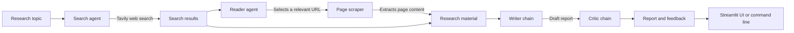

# LangChain Multi-Agent Research System

A research assistant that searches the web for a topic, extracts useful content from a relevant page, writes a structured report, and asks a critic chain to review it. Use the Streamlit interface to run the workflow interactively, or run the pipeline from the command line.

## Features

- Web search with Tavily
- Article extraction with Trafilatura, Readability, and Beautiful Soup fallbacks
- LLM-powered search and reader agents, report writer, and critic
- Streamlit UI with pipeline progress, intermediate results, and Markdown report download
- Command-line pipeline for a topic configured in `main.py`

## Requirements

- Python 3.11
- API keys for [OpenRouter](https://openrouter.ai/) and [Tavily](https://tavily.com/)
- Internet access for model requests, web search, and page retrieval

## Installation

Clone the repository and enter its directory:

```bash
git clone https://github.com/saideependra/Langchain-Multiagent-Research-System.git
cd Langchain-Multiagent-Research-System
```

Create and activate a virtual environment:

```bash
python3.11 -m venv .venv
source .venv/bin/activate
```

On Windows PowerShell, activate it with:

```powershell
.venv\Scripts\Activate.ps1
```

Install the dependencies:

```bash
python -m pip install --upgrade pip
pip install -r requirements.txt
```

Alternatively, with Conda:

```bash
conda create -n langagent python=3.11 -y
conda activate langagent
pip install -r requirements.txt
```

## Configuration

Create a `.env` file in the project root and add your API keys:

```dotenv
OPENROUTER_API_KEY=your_openrouter_api_key
TAVILY_API_KEY=your_tavily_api_key
```

The LLM is configured in `src/agents/agents.py` to use OpenRouter's `openrouter/free` model. Tavily is used by the web search tool in `src/tools/tools.py`. Keep your API keys private; do not commit the `.env` file.

## Run the application

Start the Streamlit interface:

```bash
streamlit run app.py
```

Open the local URL printed by Streamlit, enter a research topic, and select the run button. The app displays search results and extracted content, then presents the generated report and critic feedback. You can download the report as a Markdown file.

To run the command-line pipeline:

```bash
python main.py
```

The example topic is set in `main.py`; edit the `topic` value there to research a different subject.

## Architecture



The agents and chains are defined in `src/agents/agents.py`. Web search and page extraction are implemented in `src/tools/tools.py`. `src/pipeline/pipeline.py` connects those components into the sequential research workflow used by `main.py`; `app.py` runs the workflow in Streamlit and displays each stage.

## Project structure

```text
.
├── app.py                  # Streamlit application
├── main.py                 # Command-line example
├── requirements.txt        # Python dependencies
└── src/
    ├── agents/             # Search and reader agents; writer and critic chains
    ├── pipeline/           # Command-line research workflow
    └── tools/              # Web search and page scraping tools
```

## Technology stack

- **Python 3.11**
- **LangChain** for agents, prompts, and chains
- **OpenRouter** for LLM access via the OpenAI-compatible LangChain integration
- **Tavily** for web search
- **Requests, Trafilatura, Readability, Beautiful Soup, and lxml** for page retrieval and content extraction
- **Streamlit** for the interactive web application
- **python-dotenv** for local environment configuration

## License

This project is licensed under the Apache License 2.0. See [LICENSE](LICENSE) for details.


